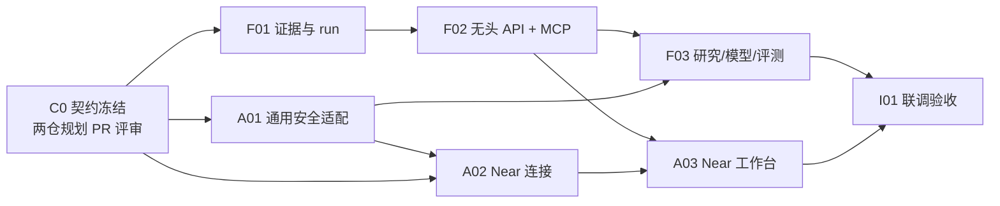

# 金融垂类研究智能体：双仓 Master Plan

Planned-with: Manus
Suggested-Impl-Model: 各子计划按风险选型，见第 8 节；实际实施模型由实施者记录
Plan-Id: 2026-10-01-finance-agent-master
Plan-Type: Master（本文件不直接实施）

> **给实施者**：本计划负责跨仓目标、冻结契约、DAG、合流门禁和 PR 顺序；不要一次性实施全部功能。执行时每个节点建立独立分支和 PR，先将对应子计划从 `.cursor/plans/pending/` 移到 `.cursor/plans/`。两个仓库分别审查/合并，不能在父仓库提交嵌套的 `AgenticX/` checkout。本轮 PR 仅交付计划文档，不声称功能已实现。

**Goal:** 将 FinnewsHunter 从新闻采集与自然语言解读扩展为可审计的无头金融研究服务，供 Near 金融工作台以 MCP + REST/SSE 使用。首个端到端用例是“从一则 A 股事件/公告出发，在 Near 查看有证据的研究 run、时点、数值校验及风险状态”。

**Architecture:** FinnewsHunter 是领域数据、证据、ResearchRun 和领域政策的权威；AgenticX 提供通用 ReAct/Flow/MCP/确认/观测能力；Near 提供交互，不直连 FinnewsHunter 数据库。只读研究优先，交易执行/券商接入/资金权限不在本波。

**Tech Stack:** FinnewsHunter FastAPI/Pydantic/SQLAlchemy/PostgreSQL/Celery/Milvus/Neo4j + AgenticX Python runtime/MCP + Near Electron/React/TypeScript。现有组件按能力复用，不引入第二个编排引擎或新的桌面运行时。

---

## 0. 基线与证据

- FinnewsHunter `backend/app/financial/{providers/base.py,registry.py,tools.py}` 已有数据 Provider 与 AgenticX `BaseTool`；`backend/app/api/v1/agents.py` 的 `execution_logs`/`debate_results` 仍为内存数据，SSE 和普通辩论路径分裂；`backend/app/api/v1/alpha_mining.py` 有 `generate_mock_data()` 实验性路径；入口为 `backend/app/main.py` 与 `backend/app/api/v1/__init__.py`。
- AgenticX 的 `agenticx/agents/react_agent_async.py`、`agenticx/runtime/graph/`、`agenticx/tools/remote_v2.py`、`agenticx/runtime/confirm.py` 提供可复用原语；`desktop/` 已有 REST/SSE、MCP 管理和确认交互；本机 `GraphRunStore` 文件状态不是 FinnewsHunter 多客户端业务 run 的权威数据库。
- 规划基线：FinnewsHunter `main@eb13a7f`，AgenticX `main@e32037e6`（执行时须重新校验代码位置及主分支变化）。本规划基于 [既有总体路线图](https://github.com/DemonDamon/FinnewsHunter) 与两个仓库当前实现，不把既有计划描述当作功能完成证明。

## 1. 冻结的跨仓契约（C0）

**所有子计划按以下 v1 约定设计；任何字段变更先改此节并同步双方，禁止分别在两个仓库定义不同含义。** FinnewsHunter 负责 OpenAPI + MCP 规范及契约样例，AgenticX 负责消费契约样例和桌面展示；客户端不得拥有另一份业务状态机。

| 对象/路径 | 必填语义与不变量 | 权威拥有者 |
|---|---|---|
| `EvidenceV1` | `evidence_id`, `source_id`, `source_url`, `content_hash`, `published_at`, `fetched_at`, `available_at`, `timezone`, `license_scope`, `entity_ids`, `excerpt`, `quality_status`；时间为含时区 ISO-8601；无有效许可不得返回全文 | FinnewsHunter |
| `ClaimV1` | `claim_id`, `kind` (`fact`/`inference`/`hypothesis`), `text`, `evidence_ids`, `as_of`, `valid_until`, `confidence`；事实不得无证据；推断与假设显著标记 | FinnewsHunter |
| `ResearchRunV1` | `run_id`, `request_id`（幂等）、`principal_id`, `entity_ids`, `as_of`, `status`, `created_at`, `updated_at`, `model_id`, `prompt_version`, `policy_version`, `result_ref`, `error_code`；状态 `queued/running/needs_review/completed/failed/cancelled` | FinnewsHunter |
| `RunEventV1` | `event_id`, `run_id`, `seq`（单 run 严格递增）, `type` (`started/step_started/evidence_added/claim_checked/needs_review/completed/failed/cancelled`), `occurred_at`, `payload`; 断线用 `Last-Event-ID` 回放且去重 | FinnewsHunter；Near 消费 |
| `ResearchBriefV1` | `run_id`, `as_of`, `claims[]`, `counterarguments[]`, `unknowns[]`, `limitations[]`, `model_trace`; 引用的 evidence 必须在同一快照且 `available_at <= as_of` | FinnewsHunter |
| HTTP v1 | `POST /api/v1/research/runs` 创建；`GET /api/v1/research/runs/{id}` 查询；`GET /api/v1/research/runs/{id}/events` SSE；`GET /api/v1/research/evidence/{id}?run_id=<id>` 在所属 run 快照中读证据；相同 `request_id` + principal 重试返回同一 run，跨 principal 不复用 | FinnewsHunter |
| MCP v1 | 只开放 `finnews.search_articles`, `finnews.get_evidence`, `finnews.get_market_snapshot`, `finnews.start_research`, `finnews.get_run`；`search_articles` 显式传 `as_of`，`get_evidence` 显式传 `run_id`；不开放 SQL、任意 URL、删除、付费或交易工具；返回 JSON 包装中保留 `schema_version`, `as_of`, `source` 与许可状态 | FinnewsHunter；AgenticX 消费 |
| 身份/权限 | HTTP 与 MCP 必须使用同一 principal 授权与资源范围；Near 本机 token 不充当金融 API 认证；对远程服务只允许受保护的 HTTPS + 机密存储；未认证/无权/失联一律 fail closed | 两仓各守其边界 |

**口径补充**：`available_at` 是系统当时实际可获得时间，不可简单替代为 `published_at`；币种、单位、复权与市场时区在行情结果中显式返回；摘要与模型主张不得作为行情或公告原文的权威副本。`start_research` 是受限研究 run 创建，不是交易动作，需 `research:create` 权限、配额和审计；发起只读研究不要求桌面端另设一次性确认，Near 仅在表单内清晰说明并由服务端执行授权。F01 提供 Evidence/Run 的可注入 Port 与 worker dispatch hook，F02 延伸既有研究路由，F03 在该 hook 上挂受限执行器；A02 提供 Electron main 持有凭据的专用 HTTP/SSE 桥，A03 只消费它。不允许把金融凭据写入普通 MCP 静态 headers。

## 2. Scope / Non-goals

**In scope:** 证据/时点、持久化研究 run、只读领域 API/MCP、一个证据化研究场景、金融领域模型的选择/评测/回退、Near Finance Workspace 的受控接入和首屏、联调契约测试。

**Out of scope:** 自动或人工实盘下单、券商登录、读取真实持仓/账户、付费新闻购买、代用户发布公开研报、收益承诺；不重写 Near/AgenticX 的通用 Runtime，不迁移采集器数据库到桌面端，不把 Alpha Mining 模拟数据包装成真实策略绩效，不另起独立金融版 Near 的完整应用。企业多租户和 HA 不是本波可默认为已完成的能力。

## 3. 子计划索引、边界与交付

全部子计划初始路径位于各仓 `.cursor/plans/pending/`，一份仅改本仓文件。每个 PR 必须附测试结果、契约版本及另仓依赖 PR 链接。

| ID | 所属仓库 / 子计划文件 | 交付范围 | 前置条件 |
|---|---|---|---|
| F01 | FinnewsHunter [`2026-10-01-finance-01-evidence-run.plan.md`](2026-10-01-finance-01-evidence-run.plan.md) | Evidence/Claim/ResearchRun 迁移、鉴权与持久化事件账本；开放领域 Port 与受控 worker dispatch hook | C0 |
| A01 | AgenticX `2026-10-01-finance-01-runtime-adapter.plan.md` | 通用、可复用的远程 MCP 安全与结构化 run 事件适配，不向 Core 植入金融模型 | C0；可与 F01 并行 |
| F02 | FinnewsHunter [`2026-10-01-finance-02-headless-mcp.plan.md`](2026-10-01-finance-02-headless-mcp.plan.md) | 只读 API/MCP、检索/行情口径、契约 fixtures 与真实 provider 降级 | F01 |
| A02 | AgenticX `2026-10-01-finance-02-near-connection.plan.md` | Near 金融 MCP 接入、Electron 安全凭据、受限 HTTP/SSE 研究桥、连接状态与模拟 fixture 消费 | A01 + C0；可与 F02 并行 |
| F03 | FinnewsHunter [`2026-10-01-finance-03-research-model-eval.plan.md`](2026-10-01-finance-03-research-model-eval.plan.md) | 证据化 Research Flow、任务模型路由、数值校验与评测门禁 | F02 + A01 |
| A03 | AgenticX `2026-10-01-finance-03-near-workspace.plan.md` | 市场收件箱、run 观察器、证据抽屉、风险状态卡与断线恢复；不新增研究创建确认门禁 | A02 + F02（契约 fixture）；可与 F03 并行 |
| I01 | 跨仓集成门禁（不新建独立计划文件） | 契约互测、端到端演示、拒答/越权/断线/许可/时间倒挂场景；双方审查批准 | F03 + A03 |

**AgenticX 子计划直接在其仓 `.cursor/plans/pending/`；此表中的相对文件链接只指向本仓 F 节点。** 另仓索引文件 `2026-10-01-finance-agent-execution-index.plan.md` 应引用此 master 的 GitHub 路径并列出 A 节点，不复制一套冲突的协议字段。

## 4. DAG 与可并行执行方式

**并行批次**：`[F01 || A01] → [F02 || A02] → [F03 || A03] → I01`。每批的两个节点可由两个独立 subagent 执行，**各自在不同仓库的独立 git worktree、独立分支、独立 PR**；先完成并评审上游节点，不允许通过复制他人的未提交工作目录冒充依赖。跨仓并行只消费已冻结契约或 fixture；若发生不兼容，暂停对应节点，先修订 C0 和两个 PR 的契约测试，再继续。I01 由集成负责人统一验收，不把合流冲突留给子 agent 猜。

## 5. 分支、PR、合并协议（强制）

- **当前这次规划交付**：两仓各建立 `docs/finance-agent-master-plan-20261001`，只提交各自 `.cursor/plans/pending/` 计划文档；分别推送并发起到 `main` 的规划 PR。FinnewsHunter 的 PR 持有唯一 master；AgenticX 的 PR 持有执行索引 + A01/A02/A03，两 PR 相互链接；仅代表“计划待评审”，不代表实施已完成。
- **以后实施**：每节点从所属仓最新 `main` 新建分支 `feat/finance-<id>-<scope>`，一个节点一个 PR。依赖未合并时，尽量用固定契约 fixtures 独立开发；若不得不基于上游未合并分支，明确标注 stacked PR base 和 rebase 策略，不能并行写同一工作树。
- **合并门槛**：C0 两个规划 PR 审阅通过后可进入 F01/A01；F01 的迁移及后向兼容测试通过才合 F02；A01 的安全测试通过才合 A02；F02 API/MCP 与 A02 fixture 合同测试通过才合 F03/A03；I01 全绿后才标记波次完成。
- **嵌套仓防误提交**：`FinnewsHunter/AgenticX/` 为独立 checkout；FinnewsHunter 父仓的 `.git/info/exclude` 保持 `/AgenticX/`，并在每次父仓 commit 前核验 `git ls-files --stage AgenticX` 为空，`git diff --cached --name-only` 仅列允许的计划/代码文件；禁止 `git add -f AgenticX`、`git submodule add` 或将其打包进父仓。
- **提交约定**：尊重 AgenticX `AGENTS.md` 的提交 trailer 与作者约束，模型名称不猜测；规划-only 提交的 `Impl-Model` 按用户确认值填写。PR 标题与正文只描述本产品变化，不写无关第三方对标。

## 6. 运行安全与降级策略

1. 无证据、许可不可展示、数据已过期、时间倒挂、ticker 冲突或数值复核失败：不得发布“事实型” Claim；返回 `needs_review` 或显式未知项。
2. 身份未验证、权限不足、MCP 连接断开或远程证书异常：金融工具不可用，Near 保留已有通用聊天；不把本地桌面 token 透传给金融服务。
3. 研究 run 写入/事件持久化失败：不得发送“已完成” SSE，客户端可重试同一 `request_id` 幂等查询。
4. 垂类模型未达离线门槛：回退到已评测的通用模型 + 检索/工具计算，或者拒答；不能默认切到未评测模型，也不以情感分数作为价格预测。
5. `auto` / 全自动模式也无法绕过领域服务端禁用交易工具、鉴权和风险政策。

## 7. I01 演示/验收矩阵

| 场景 | 输入/触发 | 必须可观察的结果 |
|---|---|---|
| 正常 | 样例 A 股事件，含合规来源、行情时点 | Near 能开始 run；断线重连读到同一 `run_id`，结果各事实 Claim 指向合法 evidence，含时点、模型和提示词版本 |
| 数据时间倒挂 | `evidence.available_at > run.as_of` | 证据不得进入该次研究，事件/错误说明原因，回归测试复现 |
| 权限隔离 | principal B 请求 A 的 run/evidence | 403 或 404，不能通过 MCP 查询泄露；审计记录可追踪 |
| 许可限制 | `license_scope=no-redisplay` | 不展示受限原文，允许按许可返回最少来源元数据，日志不落全文 |
| 来源失效 | 首选 Provider 超时，备选可用 | 明确记录实际 failover、延迟与最终 provenance；全失败给出可辨别降级 |
| 数字不一致 | 模型编造涨跌幅/单位 | `numeric-validator` 拒绝或纠正，未经复算不得以“事实”输出 |
| 模型未就绪 | 财经微调模型不存在或未通过评测 | 使用已批准回退或拒答，`model_trace` 和 UI 提示准确 |
| 风险动作 | 请求交易、券商权限或外发受限内容 | 不存在交易工具；受限动作在策略/审批前停止，不因 Near 自动模式跳过 |

I01 至少跑双方单测、契约 fixtures 测试、FinnewsHunter API/MCP 冒烟、Near UI 测试及一条隔离环境的端到端路径。记录命令/结果、已知缺口、回滚步骤；不能以 mock 量化收益当验收依据。

## 8. 角色、工作量、推荐实施模型与停止条件

| 节点 | 粗估（非承诺） | 推荐实施模型档位 | 原因与 Reviewer |
|---|---|---|---|
| F01 | 1–2 周 | 代码专精中档 + 强推理审查 | 数据迁移、越权与审计高风险；Reviewer 聚焦时点和幂等 |
| A01 | 约 1 周 | 代码专精中档 | 通用适配与鉴权回归；Reviewer 聚焦 SDK/Studio 边界 |
| F02 | 1–2 周 | 代码专精中档 | 服务协议、MCP/HTTP 一致性与数据质量 |
| A02 | 约 1 周 | 代码专精中档 | 配置与凭据安全、远程连接/重连 |
| F03 | 2–3 周 | 强推理 + 金融领域审查 | 证据化工作流、模型路由、数值与评测 |
| A03 | 2–3 周 | 前端视觉/交互能力强的模型 | 高密度桌面信息架构、状态恢复与辅助功能 |
| I01 | 约 1 周 | 强推理集成审查 | 跨栈回归、失败路径、用户可见效果 |

每项先 TDD 实现自身子计划，PR 通过本仓 CI、代码评审和安全评审；上线前重查数据许可、模型卡、数值正确性与试点权限。**停止条件**：出现授权/数据许可不明、主分支代码与计划相冲突、MCP 身份无法传递或结论无法回指证据时，不自行放宽约束；修订计划及契约后再实施。
