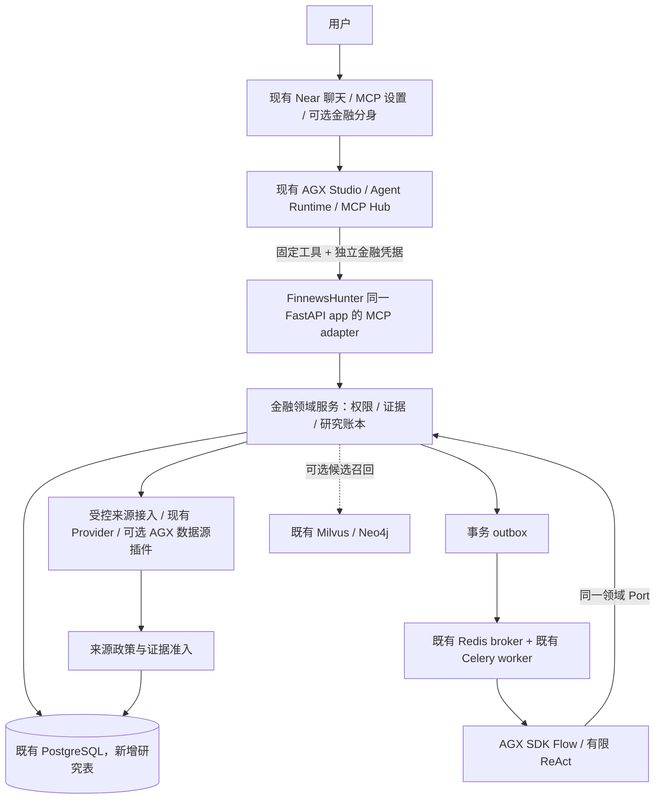
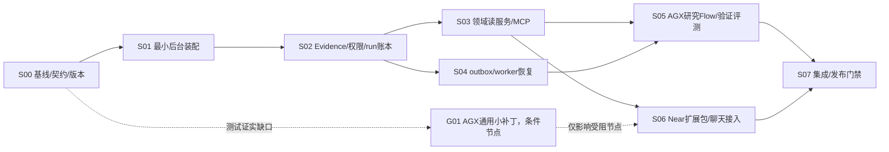

# FinnewsHunter Agent-First 金融领域后台：Master Plan

Planned-with: Manus 2.0
Suggested-Impl-Model: 后续子计划按第 13 节选择成本最低且能力足够的实施档位；实际模型名称由实施时确认，不在本规划中猜测。
Plan-Id: 2026-10-29-finnewshunter-agent-first-master
Plan-Type: Master / 仅规划，不直接实施
Status: Accepted direction / 2026-10-29 用户授权逐批实施；具体节点按验收门禁推进
Version: 1.2
Owner: FinnewsHunter；AgenticX 侧只维护引用本文件的执行索引和通用能力子计划
Author: Damon Li
Baseline-Date: 2026-10-29
Execution-Baseline: FNH 89c50de283d87de07c358b39e8d9e1e1b59eeb55；AGX ebe368530fb478b8fbfc02e6316da5cbccef1a19；SDK 实测选择见 S00 兼容报告
Supersedes-Execution-Order: 2026-10-01-finance-agent-master

> 本计划将 FinnewsHunter 定位为 **agent-first 的金融领域后台**。用户继续从 Near 使用金融能力；AGX 提供智能体运行、工具连接与扩展机制；FinnewsHunter 在现有后端中提供金融证据、研究运行及领域政策。不新建用户入口，不另建金融版 Near，不复制 AGX Runtime，不为 MCP 另起一套生产服务。本文件只交付规划，所有新增路径、接口、测试及配置均为拟实施内容，除非明确标为现状。
>
> 后续 subagent 必须先读取本文件，再读取分配到的独立 subplan。Master 不是一次性代码生成任务。2026-10-29 用户已授权逐批实施；S00 开始于隔离 worktree。真实采集、付费模型、生产迁移/部署及未授权的远端提交仍不在本轮动作范围；不因文档存在而声称功能完成。

## 1. 要做成什么，为什么现在这样做

FinnewsHunter 不再以自己的网页作为主要使用入口，而成为 Near 背后的金融领域能力提供者。用户在 Near 对话中提出“分析某个事件对某只股票的影响”，Near 使用已经存在的 MCP 连接发起受限研究，再获取带来源、时点和限制说明的结果。用户不需要打开另一个客户端，也不需要理解后台数据库或任务队列。

这里的 agent-first 是“后台能力优先设计成可被智能体安全调用的工具与结构化契约”，而不是把整个后台改成一个自由行动的 Agent。采集、权限、证据登记、数值核验和运行状态仍是确定性代码。只有需要解释、生成候选主张和审阅的部分交给模型。

第一版验证一个闭环：**一个已入库且有合法来源的 A 股事件 + 一只股票 → 一个可恢复的研究运行 → 一份有证据的研究简报 → 在 Near 现有聊天中查看和追问。** 第一版不是自动交易系统，不证明投资收益，也不训练金融大模型。

保留 `FinnewsHunter` 仓库名。可以调整 README 的产品描述，但不在本波迁移仓库 URL、包名、镜像名或部署名称。原 `frontend/` 保留为遗留操作/开发界面，不扩展成新的研究入口，也不在本波删除它。

## 2. 已核实的基线与旧计划处理

### 2.1 两仓真实状态

FinnewsHunter 已合并规划 PR #16，远端 `main` 为 `89c50de283d87de07c358b39e8d9e1e1b59eeb55`。合入的是四份 pending 计划；尚无研究账本、研究 HTTP 路由、金融 MCP server 或研究 worker 实现。[1]

AGX 本次远端主线为 `a1da6f963f2d14a285f830ada2ab61ad8e8f5768`。此前旧计划的 AGX 基线为 `e32037e6`；两者之间已有 452 个提交。因此不能直接照旧计划新增通用框架功能，必须先验证当前能力是否已经足够。[2]

AGX 当前源码 `pyproject.toml` 声明版本 `0.6.5`，GitHub 最新发布标签也为 `v0.6.5`，但标签对应源提交是 `0fc089ec6bf0b45f48a7beda06907932ebc98998`，并不等于当前 `main`。FinnewsHunter 已提交的依赖仍是 `agenticx==0.1.9`；本机未提交的 `0.2.0` 修改不是经过兼容验证的升级。这三者不能混作同一运行版本。[3] [4]

AGX 侧 A01/A02/A03 配套计划存在于 **未合并 PR #65**，head 为 `11d333d2b2070cb990e8980e5e655e38b142c1b7`；它们不在 AGX 当前主线。不能把“主线没找到”误解成“从未规划”。该 PR 未经本次授权不会自动合并。[5]

本地已有用户修改。FinnewsHunter 主工作树在核查时落后远端两条提交；AGX 本地 HEAD 为 `44d6c050`，远端新增一条文档提交。本任务只更新过远端引用，不覆盖本地修改。后续实现默认使用从最新已审阅主线创建的独立 worktree，而不是强行清理用户目录。

### 2.2 当前可复用的 AGX 能力

Near 已有 Settings → MCP、凭据设置、聊天工具卡、会话历史和自动连接恢复。连接配置经 Electron 的受限接口交给 Studio；Agent 使用现有 `mcp_connect` / `mcp_call` 调用工具。首期不需要金融专用客户端或侧栏。[6] [7]

AGX 已有 `Flow.kickoff_async()`、异步 `ReActAgent.astream()` / `arun()`、`MCPClientV2`、数据源插件与评测抽象。但这些组件不自动保证金融证据的时点、许可或事实正确性，也不是 FinnewsHunter 多客户端业务账本。[8] [9] [10]

`DataSourceResult` 当前只有 `source/api/data/as_of/attribution/warnings`。其中 `as_of` 可能只是日期或年度，`attribution` 是展示文字，不代表许可证。金融适配器必须补齐可信元数据或拒绝登记；不能把该对象直接改名为 Evidence。[11]

### 2.3 本 Master 对旧计划的变更

保留旧计划的安全原则：同一 principal 授权、时间可得性、按 run 限定证据、事实引用、事务事件账本、mock 隔离以及模型评测后启用。

调整实施顺序：将 AGX 版本兼容验证前移；将现有服务的最小部署放在接线前；先通过 MCP 和现有 Near 聊天完成闭环，再决定是否需要专用研究视图。旧 A02 的金融专用 Electron HTTP/SSE 桥和 A03 的新侧栏均移入后置候选，不是第一版前置。

缩小旧 A01：不先实现一整套 `ProtectedRemoteMcpFacade` 或通用外部事件框架。先用现有 remote MCP、凭据引用与领域 JSON envelope。只有兼容或安全测试证明现有实现无法满足要求，才开启独立的 AGX 通用缺口子计划。

补齐旧计划的具体问题：同一个 FastAPI app 的 MCP mount/lifespan；claim 后 worker 崩溃的处理；固定 `as_of` 与新采集的矛盾；完整 Brief 的读取路径；市场数字与 Evidence 的关联；Near 聊天与服务端研究结果的状态区别；旧模型 bootstrap 与研究迁移的隔离。

本文件是新的执行顺序建议，不自动宣称旧 C0 契约已变更。第 6 节的增补须在 S00 文档评审中登记为 `C1 / research-v1.1`，同步两仓并生成版本化 fixture 后才能实施。PR #65 应先修订、引用本 Master 并移除首期强制新侧栏的要求；不建议原样合并后再照单施工。

## 3. 架构与不能跨越的职责边界



**Near：用户入口。** 保持现有会话、模型选择、工具卡和配置界面。金融分身是可选职责预设，不是另一个应用。普通聊天可以检索和解释，但不能自行宣布后台研究已完成，也不能修改领域许可或审计状态。

**AGX：通用底座。** 提供智能体循环、Flow 编排、工具抽象、MCP 连接、扩展安装、模型 provider 和评测组件。框架中不新增金融业务表、股票状态机、行情许可清单或券商工具。AGX 的会话/技术运行 ID 只作相关性标识，不能替代 `ResearchRun.run_id`。

**FinnewsHunter：金融领域权威。** 负责来源政策、证券实体、证据快照、研究运行、幂等、权限、事件、数值核验、模型使用政策和研究产物。外部入口是工具/API，而不是另一个网页。其模型调用也复用 AGX SDK，不自行实现另一个 ReAct loop。

**现有基础设施：按需使用。** PostgreSQL 是领域状态权威。Redis 只做现有 broker/缓存；Celery 是执行载体，不是第二个研究状态库。Milvus/Neo4j 只可提升召回，首期不可成为必须启动的服务。AGX Enterprise Gateway、Portal、Admin、托管 Agent 和 Data Suite 不列入本波依赖。

同一个研究运行只由 FinnewsHunter worker 执行。Near Agent 负责调用 `start_research` 和读取结果，不再并行组织一套“第二份多空辩论”作为这个 run 的正式结果。后台研究与聊天解释可以共存，但 UI/SOP 必须区分二者。

## 4. 范围、最小场景和不做事项

### 4.1 本波交付

1. 可独立启动的现有金融后端研究模式，仍是 `app.main:app`；不要求遗留前端、Milvus、Neo4j 或 beat。
2. 来源准入和独立 Evidence 存储，不猜测历史新闻元数据。
3. 受保护的研究 run、事务事件账本及可诊断的 worker 恢复。
4. 固定五个 MCP 工具；官方 SDK 的 ASGI adapter 与现有 FastAPI 同 app、同进程部署。
5. 一个 AGX SDK 驱动的单事件、单股票研究 Flow，以及确定性引用/数值检查。
6. Near 现有 MCP 连接与聊天中的实际闭环；可安装的金融 SOP 扩展包。
7. 版本锁、契约 fixture、离线评测、真实进程故障测试和操作手册。

### 4.2 本波不做

不新建客户端、金融版 Near、Web 控制台或新的独立 MCP 生产进程。不做交易、券商登录、持仓账户、付费内容采购、公开研报发布或收益承诺。不做模型微调、全市场研究、连续监控、自动选股或因子绩效演示。不迁移全部历史新闻，不改写遗留多空辩论，不为研究需求重构整个 AGX。

不把已有 data-source GUI 的“可见”当成依赖已安装或许可已获得。不把“只读”当作无成本：研究创建会消耗模型费用和计算配额，仍需显式用户研究意图、服务端授权、预算和审计。

### 4.3 第一个验收用例

固定证券实体 `CN.SH.600519`，固定一个有出处的事件 Evidence。测试中使用可再分发、明确标记 `fixture` 的合成证据；staging 演示使用经批准的真实来源，不能把合成资料或历史 mock 行情讲成真实事件。

Near 中的操作是：检索已有资料 → 用户表达研究意图 → 调用 `finnews.start_research` → 展示服务端 `run_id/status` → 有界调用 `finnews.get_run` → 获取带 evidence 引用的 Brief → 按 `run_id` 调用 `finnews.get_evidence` 查看允许的引用。研究耗时超过单轮预算时，聊天结束本轮并提供稍后查询指引，不持续空转轮询。

未通过模型 gate 时仍可演示真实检索和 run 状态，但不能演示“正式研究完成”。MCP fixture 连通仅证明传输，不等于真实数据接入或金融正确性。

## 5. 启动与部署：让现有仓库先可控地转起来

### 5.1 必须先解决的启动事实

当前 `backend/start.sh:14–29` 使用全量 compose 启动并允许旧初始化失败后继续；`deploy/docker-compose.dev.yml` 的 worker/beat 又依赖 Neo4j。它不是研究最小启动方案。当前 `backend/app/main.py:69–106` 每次 lifespan 尝试图谱初始化，路由聚合还会导入遗留分析和 Alpha 模块。[12] [13]

本波保持同一个 FastAPI 入口，但引入明确的研究模式。默认保持遗留行为；研究模式仅装配研究路由及 MCP，避免遗留重依赖和随机/训练路径的导入。健康检查区分“进程活着”和“研究是否就绪”，不能沿用总是返回 healthy 的状态代表完整能力就绪。

### 5.2 拟配置与实际落点

在 `backend/app/core/config.py:Settings` 新增 `APP_MODE=legacy|research`，默认 `legacy`；新增 `RESEARCH_ENABLED`、`RESEARCH_EXECUTION_ENABLED` 和已审核来源开关，默认关闭。`backend/app/api/v1/__init__.py:api_router` 改为受控工厂或等价条件装配：legacy 仍注册原路由；research 只注册研究模块。禁止整段覆盖既有 imports。

在 `backend/app/main.py:lifespan` 与 `app = FastAPI(...)` 附近，仅做 composition-root 改动：按模式跳过可选图谱初始化；合成 MCP session-manager lifespan；固定挂载 MCP adapter。普通 CORS、Docs、异常处理与原 API 前缀不随手改动。

在 `deploy/docker-compose.dev.yml` 中增加或配套 override 一个显式 `research` 运行组合：使用同一 PostgreSQL、Redis 和 Celery worker 定义，不新建研究微服务。遗留 worker/beat 的默认行为要保持；research override 移除对 Neo4j 的硬依赖，worker 只订阅研究队列且不启 beat。Milvus/Neo4j 保留为显式选用的 legacy/检索组件，不删除 volumes。

`backend/start.sh` 增加参数化模式和健康等待，不固定 sleep 10 代表数据库就绪。研究迁移失败必须非零退出，不能用 `|| echo` 吞掉。计划阶段不执行该脚本。

### 5.3 分阶段硬依赖

兼容性探针和 fixture 传输测试：独立虚拟环境与测试 MCP；不依赖真实金融库。

证据/账本/API：PostgreSQL、已确认的金融身份验证配置。worker 未就绪时 `start_research` 必须返回 `execution_unavailable`，不能创建永久 queued run。

实际异步研究：再加入既有 Redis 和 Celery worker，以及已批准模型和合规数据。向量/图谱故障返回可解释的召回降级，不阻断研究账本或造成假成功。

### 5.4 MCP 与 HTTP 的共部署约束

目标 canonical endpoint 为 **`/api/v1/mcp`**，由同一个 `app.main:app` 提供 Streamable HTTP。厂商 SDK 的内部默认 `/mcp` 路径须在 mount 时显式归一化，禁止最终变成 `/api/v1/mcp/mcp` 或靠重定向碰巧连通。

新增 `backend/app/mcp/finnews_server.py:create_finnews_mcp_app()`，返回 ASGI app 与 lifespan/context 绑定。认证中间件必须覆盖 initialize、list_tools、call_tool 等每次请求；session ID 不是认证凭据，同一 session 不能从 principal A 被 principal B 接管。工具处理器通过 request context 获得已验证身份，不在共享 server 实例上保存可串用户的全局 principal。

先在隔离环境验证官方 MCP SDK 版本的 mount、session lifecycle、Origin/Host 校验和取消行为，失败则修正 adapter，不另起一个生产 Uvicorn。若当前 SDK 确实无法可靠共部署，这是 S00/S03 停止点，需要回到 Master 评审，而非子 agent 自行增加服务。

部署仍可由现有 HTTPS 反向代理接入。不新建身份平台或网关；真实域名和认证材料在 staging 前由部署方提供。公网只开放受保护的新研究/MCP 路径，不顺带暴露遗留 debug、llm config 或无身份的旧新闻正文接口。

## 6. C1 / research-v1.1：统一领域契约

本节是拟冻结契约。旧 C0 的字段原则保留；以下增补在 S00 审阅后成为两仓唯一语义，客户端不得自定义第二套 schema。Pydantic/JSON Schema 在 FinnewsHunter 生成并提交 manifest；AGX 消费对应版本，不复制业务模型实现。

### 6.1 基本约定

ID 使用 UUID 字符串；实体使用 `CN.SH.600519` 这类含市场的 canonical ID，首期 `entity_ids` 长度严格为 1。兼容输入 `SH600519` 在边界一次性规范化；不能对不明确证券名猜测交易所，歧义输入返回 `ambiguous_entity`。

时间必须是包含 offset 的 ISO-8601，数据库使用 timezone-aware 时间类型，统一保存 UTC，并保留市场 IANA 时区。数值用十进制字符串与明确单位，不以二进制 float 作为最终核验权威。用户 `as_of` 不得为未来；不得静默改为服务器当前时间。

统一 MCP envelope 必填：`schema_version="research-v1.1"`、`request_id`、`status=ok|partial|unavailable|error`、`as_of`、`data`、`source[]`、`license_status`、`warnings[]`、`error`。`error` 在成功时为 null，否则含稳定 `code`、安全 `message` 与 `retryable`；不含 token、堆栈或原始 prompt。每条来源给 `source_id/evidence_id/provider/version/hash`，不是一个无法追踪的 provider 名字符串。

MCP `isError` 与 envelope 的状态必须一致；`partial/unavailable` 不是伪造完整成功。服务端 text block 中的 JSON 与 structuredContent 表达同一对象，避免 AGX 当前文本优先提取丢失结构内容。参数和 JSON schema 设置有界长度、分页上限以及禁止任意额外字段。

### 6.2 Evidence 与来源政策

保留 EvidenceV1 必填字段：`evidence_id, source_id, source_url, content_hash, published_at, fetched_at, available_at, timezone, license_scope, entity_ids, excerpt, quality_status`。来源 URL 只能来自批准来源策略；工具不能让调用者传任意 URL。

增补 `evidence_kind=event|market`、`version`、`source_policy_version`、`origin=live|fixture`；market 类型再关联内部 `MarketPayloadV1`。quality 只允许 `verified_metadata|incomplete|rejected`；后两类只可进入内部隔离记录，不可进入研究快照。数据来源可信与“主张为真”不是同一概念。

生产研究只接受 `origin=live`。fixture 仅限独立测试环境；测试开关不得通过 MCP 参数开启，公开部署不得装载 fixture executor。`origin=fixture` 与 `is_mock` 均要独立测试，不能把“不是随机 K 线”误当成“真实金融证据”。

来源政策内部记录 `license_id/terms_ref/approved_at/expires_at/redisplay_allowed/model_use_allowed/storage_allowed/allowed_excerpt_length`，并生成 `license_scope` 投影。批准人必须确认权利范围；不是代码填一个 allowlist 就获得许可。unknown 或到期默认拒绝；受限原文不能经 prompt、日志、向量 payload、聊天历史或 fixture 泄漏。`no-redisplay` 的最少元数据是否可返回也按实际政策判断，不默认有权训练或送模型。

历史 `News` 不批量回填成 Evidence。仅在来源、时区、可得时点与许可可以逐项证明时，通过受控 adapter 登记新的独立记录，并保留到原 news ID 的可选内部关联。缺失 `available_at` 不能用 `published_at`、旧 `created_at` 或本次 `fetched_at` 猜测补齐。

### 6.3 时点与采集顺序

固定不变量：`Evidence.available_at <= ResearchRun.as_of`。`available_at` 表示该系统首次实际可获得该版本数据的可信时间，不等于原文发布时间，也不是数据库入库时随便赋值。

**首期工具查询只读已经登记的证据/行情版本，不在固定 as_of 查询里偷偷 live refresh。** 新采集由内部受控 ingestion 完成；登记在完整元数据检查后进行，不要求它满足一个尚未创建的 run 的时间上界。随后用户新建 run，选择不早于该数据可得时间的 as_of。

例：事件 09:00 发布，系统 10:02 首次取得它。`as_of=10:00` 的研究不能使用该事件，即使 10:05 查询时已入库。新研究设为 `as_of=10:05` 且使用新 `request_id` 才可以纳入。原 run 的 request_id 改 as_of 返回 409。

run 开始时物化选定时点的快照成员，并在写第一条 Claim 前原子冻结。冻结后不得增加成员、替换版本或补入刚获取的行情。研究失败重试不允许改变快照；资料补全必须开新 run。市场历史数据若今日才取得且没有可信历史可得记录，不能被当作系统当时已拥有的回测证据。

### 6.4 行情与数值证据

`MarketPayloadV1` 必填 `evidence_id, symbol, observed_at, available_at, fetched_at, timezone, currency, adjustment, fields, provider, version, is_mock`。`fields` 每项含 `name/value/unit`；价值为 Decimal 字符串。行情通过同一个 Evidence 登记与快照绑定流程，保证数字 Claim 的 `evidence_ids` 能引用市场数据，而不是引用一个不存在的行情摘要。

`is_mock=true` 一律不进正式研究。币种、单位、复权口径或时间缺失，返回 `market_data_unverifiable`。允许事件型研究在没有行情时产出非行情结论与明确未知项，但不得编造涨跌幅；要求行情数值的研究应进入 needs_review。

AGX 数据源插件可以提供原始候选，不授予其返回结果权威地位。首期最多接入一个获得批准的市场 adapter；其他插件仍为后续候选。AkShare 缺包、Tushare MCP 不可用、iFinD stub 均必须明确 unavailable，不能以随机行情替代。

### 6.5 Claim 与 Brief

Claim 必填 `claim_id, kind=fact|inference|hypothesis, text, evidence_ids, as_of, valid_until, confidence`。`confidence` 在 0–1；未知不是高 confidence 的推断。fact 必须有同一 run 快照内的证据，并通过结构、许可、时点和引用检查。

内部数值主张追加 `numeric_assertions[]`：`evidence_id, field, claimed_value, unit, currency, formula_id, operand_refs[], rounding`。仅允许预定义 `identity`、`percent_change`、`unit_scale` 公式，不允许 eval/任意表达式。百分比与百分点严格区分；输入缺失、零分母、币种/复权不同不可“自动纠正”。不能复算的数字不得升级成 fact。

Brief 必填 `run_id, as_of, claims[], counterarguments[], unknowns[], limitations[], model_trace`。反方论据也必须有证据或标明推断，不等于交易建议。model_trace 保留实际角色模型、prompt/policy/eval 版本与回退原因，不保存密钥、受限全文或模型内部思考原文。

**读取路径增补：** `GET /research/runs/{id}` 和 MCP `get_run` 的 data 返回 ResearchRunView，即既有 ResearchRun 字段加 `brief: ResearchBriefV1|null`。completed 时服务端加载本地已发布产物；不让 Near 跟随 `result_ref` 发起任意 URL。result_ref 是内部不透明引用。此增补解决旧计划只有 result_ref 却没有合法 Brief 读取路径的问题。

每次读取与发布重新验证当前访问权和来源许可，不能只依赖创建时的批准。许可撤销后可以返回安全的 run 状态，但不再返回受限 Brief/证据内容，附 `license_revoked`；保留历史 completed 与审计事实，不篡改历史为一个从未发生的失败。缓存与 Near 历史的访问/清理策略须在 staging 前确认，本波不承诺已经撤回用户此前复制的内容。

### 6.6 Run、状态和事件

Run 保留 `run_id, request_id, principal_id, entity_ids, as_of, status, created_at, updated_at, model_id, prompt_version, policy_version, result_ref, error_code`，内部增加请求哈希、快照冻结时间、执行 token 和超时字段。身份来自已验证 bearer，客户端不能自报 principal。

创建唯一键 `(principal_id, request_id)`。相同键和规范化请求哈希返回同一 run；不一致返回 409。哈希覆盖实体、seed evidence、as_of、问题、schema 和研究策略版本。仅首次创建写 outbox，不能重复消耗额度。服务端返回 `model_id` 等空值键，不凭空声称已使用模型。

首期状态：`queued → running → completed|failed|needs_review`；queued 可转 failed/cancelled，running 可在内部取消后转 cancelled。completed/failed/cancelled 是终态；**needs_review 首期也是停止执行的稳定结果，不自动再跑**。未实现人工复核/恢复 API，不伪造恢复按钮。新资料或新模型需要新 run/new request_id，可记录 parent_run_id 作为可选内部追踪。

HTTP 仅新增四条领域路径：`POST /api/v1/research/runs`、`GET /api/v1/research/runs/{id}`、`GET /api/v1/research/runs/{id}/events`、`GET /api/v1/research/evidence/{id}?run_id=<id>`。创建/读取 run 返回 ResearchRunView；证据读取返回许可允许的 Evidence 投影；SSE 返回提交后的 RunEvent。HTTP 与 MCP 的传输包装可以不同，但同一身份、参数和资源必须得到相同领域判定，不重复注册路由。

事件保留 `started, step_started, evidence_added, claim_checked, needs_review, completed, failed, cancelled`。每条必填 `event_id/run_id/seq/type/occurred_at/payload`。单 run seq 严格递增；状态、事件和审计在同一事务提交。首期不为自动重跑增加 retry_scheduled，因为第 7 节采用保守的“执行丢失则失败”策略。

SSE 提供独立 `/api/v1/research/runs/{id}/events`，使用 event_id 作为 `id`，校验 `Last-Event-ID` 属于该 run 后回放后续 seq。Near 首期不订阅这个 SSE；它用于服务契约与诊断，未来 UI 可消费。Near 自身 chat SSE、ReAct FinalEvent、Celery result 都不是领域 completed 的权威证明。

### 6.7 固定五个 MCP 工具

- `finnews.search_articles`：输入 `query`、单实体 `entity_ids`、必填 as_of、`limit` 默认 10/最大 20、可选 opaque cursor。只返回已登记且授权的资料预览，不自动把它们附到任何 run。query 限 256 字符，不接受任意 URL/SQL。
- `finnews.get_evidence`：输入 `evidence_id` 和必填 `run_id`。仅读取当前 principal 所属 run 的快照成员；不因为搜索预览展示过而放宽正式读取。
- `finnews.get_market_snapshot`：输入单实体、必填 as_of、可选 run_id。读已登记市场版本；run_id 存在时必须是其快照成员。没有合格数据返回 unavailable，不触发旧 K 线 mock fallback。
- `finnews.start_research`：输入 `request_id`、单实体、必填 as_of、必填 `seed_evidence_id` 和可选 `question`，question 最大 2000 字符。创建有限研究 run，不接受 provider/model、任意上下文或工具列表。research:create、配额、证据权限和 executor readiness 检查通过后才能写 queued。
- `finnews.get_run`：输入 run_id；返回授权的 ResearchRunView。允许有界轮询；单聊天轮最多 3 次，遵循服务端建议间隔，之后返回状态供用户稍后查询。

服务端只注册这五个原始名，精确集合必须被测试。AGX Hub 可能为名称冲突加前缀；SOP 使用 discover 返回的 routed name 与 original name，不写死猜测映射。禁止把 SQL、任意 URL、shell、模型配置、删除、交易或内部 Evidence 登记工具暴露给 MCP。

### 6.8 身份、安全与预算

沿用旧 C0 的独立金融 bearer 身份和 scope：create 需 `research:create`，run/evidence/read 需 `research:read` 与实体范围。验证 issuer、audience、过期和允许的非对称算法；JWKS/公钥材料不可用时 fail closed。不新建 SSO 产品；测试使用临时测试密钥，staging 使用部署方确认的签发方。没有真实身份输入可以开发测试，不能宣称远程已可用。

远程只允许 HTTPS、固定 origin 和 endpoint；不跟随跨域重定向，查询参数不得携带 token，金融 token 不得等于 Near/Studio 管理 token。credentials 配置保存引用，不保存 literal bearer；vendor token 留在金融后台，Near 只保存调用金融服务的低权限 token。

AGX 现有 CredentialStore 是权限保护的 YAML，不是 OS Keychain；录入时 password input 会短暂位于 renderer 内存，但保存后列表接口不能读回 value。首期接受的本地威胁模型须在 S00 评审确认；文档不得声称“token 从未进入 renderer”或“已实现加密 vault”。若用户要求 OS 加密存储，需开启 G01，不应偷偷用明文满足更强承诺。[14]

金融 server 禁止 sampling。MCP 客户端不注入 llm_provider；远端不能请求本地模型反向处理 prompt。服务端硬 allowlist 和权限是不可绕过边界，UI 工具禁用/配置 `enabled_tools` 不是安全授权。整个 Near 仍有通用 shell 等能力，本计划不声称将用户整台电脑变成金融专用沙箱。

第一版建议运行预算：Flow 最大 8 次 ReAct 迭代、16 次只读工具请求、单 provider 20 秒、模型调用 60 秒、总 run 180 秒。均为拟默认配置，不是测得性能；用户/部署方可收紧，客户端不能提升服务端上限。额度拒绝返回 `quota_exceeded`。创建不是交易审批，无额外重复确认弹窗，但 SOP 必须根据明确用户研究意图才创建，不静默连续扣费。

## 7. 可靠执行：不让 run 永久排队或永久运行

### 7.1 一个权威账本，至少一次投递

创建事务同时写 ResearchRun、审计和 outbox。dispatcher 从 outbox 投递 JSON task，固定名 `finnews.research.execute_run.v1`，使用现有 Redis/Celery，独立 research 队列。task 仅传 `run_id/dispatch_id/contract_version`，不含 bearer、正文、密钥或用户任意代码。

队列允许重复 delivery。worker 用行锁从 queued 原子 claim 一次运行，生成不可猜测 execution token；后续所有状态、事件和 Brief 写入必须携带该 token 并验证未过期。task 是否可信还需验证 dispatch_id 与数据库匹配，不信任仅可猜到 run_id 的任意消息。

### 7.2 首期保守恢复策略

首期不做执行过程的自动跨进程续跑。每 10 秒心跳，lease 60 秒；run 总预算默认 180 秒。worker 被 kill、进程退出或 lease 过期后，现有 dispatcher 的监督循环检查 stale run，原子撤销 token 并发布 `failed/error_code=worker_lost`。旧 worker 迟到的写入被 fence 拒绝。修复后以新 run/new request_id 重试，不在旧快照上偷偷扩大资料范围。

dispatcher 在现有 FastAPI lifespan 中作为轻量后台监督 task；用 PostgreSQL 锁避免多实例同时投递或监督同一行。它不是新的 daemon/service。应用全停期间不承诺自动修复；应用重启后扫描 stale outbox/run 并失败收口，操作手册说明这一点。

首期 queued 超过 120 秒仍无 worker claim 则 failed/dispatch_timeout。execute 开关关闭、worker 未注册或 readiness 过期时 start_research 拒绝创建。registry heartbeat、broker 连通与开关共同决定 ready，不用“Python 模块可导入”替代真实 worker 就绪。

Celery 的 acks_late 和 worker_lost/redelivery 行为要在 research task 局部设置并测试，不全局改变旧 crawl task 语义。数据库原子 terminal publication 保证只发布一份 Brief；**不保证外部 LLM 调用 exactly-once**，worker 崩溃时费用可能已经发生，必须真实记录已知/未知成本。

### 7.3 事务伪代码

```text
create_run(principal, request):
  validate auth, scope and request shape; calculate request_hash
  BEGIN
    lock principal + request_id key; lookup existing run
    if existing and hash differs: reject 409
    if existing and same hash: audit retry; return authorized existing
    validate evidence eligibility and executor readiness for new run
    lock quota row / enforce principal concurrency bound for new run
    insert queued run + one outbox + audit
  COMMIT

claim(dispatch_id, run_id):
  BEGIN
    lock run; validate dispatch belongs to run
    require status == queued
    issue execution token; set running + lease; write started + audit
  COMMIT

publish(token, brief):
  BEGIN
    lock run; require running, valid token, unexpired lease
    require frozen snapshot and all deterministic gates passed
    save immutable Brief + set completed + append completed + audit
  COMMIT

reap_stale_run(run):
  BEGIN
    lock run; recheck deadline/lease
    revoke token; set failed; append failed + audit
  COMMIT
```

幂等重试先识别已存在 run；executor readiness 或额度变化不能阻止授权用户读取自己的原 run，也不能再次扣配额。实际事务实现须据此避免重试返回新错误或新 run。

真正的自动恢复、checkpoint 重放与重试事件可在未来独立契约版本加入。不得用 AGX 本机 GraphRunStore/CallLedger 文件当作数据库 run 的影子状态机；技术 checkpoint 如使用也必须标明非权威、按 principal 隔离且不保存受限正文。

## 8. AGX SDK 研究流程：薄接线，不重造框架

### 8.1 选择稳定版本而非直接追 main

S00 在干净环境比较 `v0.6.5` 发布物与必要的固定 full-40-char commit；记录实际 distribution/version、Python、MCP、FastAPI、resolved dependencies 与 source commit。首先尝试发布版本，只有能力测试确实缺失才选已审阅 commit。范围/浮动 main/本机 editable 不是交付 pin。

requirements 与镜像统一升级，由 S00 独占依赖文件变更；不等到研究 Flow 已写完才发现 Docker 中仍是 0.1.9。不会为此修改用户当前未提交的 0.2.0 行；新 worktree 里从远端版本重新建立可测的升级提交。

兼容测试必须真的调用 Flow 和 ReAct，而不是只 import。ReAct 构造参数为 `llm/tools/system_prompt/max_iterations/...`；`await flow.kickoff_async()` 和 `async for event in react.astream(query)` 是正确入口。Flow 没有 `arun()`，其技术状态不等于领域 run。[8] [9]

### 8.2 拟研究步骤

```text
claim 后进入 EventStockResearchFlow：
  load_run_and_authorized_seed
  → materialize_point_in_time_snapshot
  → freeze_snapshot
  → draft_structured_claims（有限 ReAct，只读当前快照）
  → deterministic_structure_time_license_numeric_checks
  → citation_review（受约束模型，不能越过确定性检查）
  → render_brief_with_actual_model_trace
  → fenced_publish 或 needs_review/failed
```

模型只能看允许的 Evidence 投影；文本作为不可信资料，不作为工具指令。ReAct 首期工具实例固定为 snapshot search、get evidence 和 snapshot market 三个读能力；不包含 start_research，以免 worker 递归创建研究。参数中的 principal/run_id/as_of 在 adapter 固定，模型不能覆盖。

worker 内调用同进程领域读 Port，而非回环 HTTP 请求自己的 MCP。这不是另一套金融逻辑：MCP adapter 和 Flow tool adapter 共用同一个 FinancialReadService/领域 Port。Near 对外仍只通过 MCP 使用工具。

### 8.3 同步/异步实际接口的接线注意

当前 ReAct `_execute_one_tool` 校验参数后在线程 executor 中调用 `tool._run`，并非直接 await `_arun`。不能把 loop-bound 的异步数据库 session 放进跨线程 `_run`，也不能跨多个 event loop 复用同一个 MCPClientV2。[9] [15]

首期 snapshot 已物化并冻结。ReAct 的 `_run` 从不可变、已授权、已投影的内存快照做有界只读查询，无网络连接与异步 DB session；Flow 的 load/freeze/publish 仍在原 async 服务调用中完成。这样不需要改 AGX 核心，也不复制其执行循环。若后来确需 ReAct 内动态远程 I/O，再独立验证现有 RemoteTool 的 loop affinity 并开 G01，不临时在后台直接 asyncio.run 共用连接。

### 8.4 事件映射与事实门禁

Flow 每一步由应用 adapter 经领域 Port 发 `step_started`。ReAct tool_call 只记录工具名/相关性 ID 和安全阶段；tool_result 先解析 envelope、验证 schema，才将合法 Evidence ID 映射为 claim/证据事件。reasoning/token 原文不进审计。ReAct `FinalEvent` 只是候选生成完成；必须通过验证并提交数据库后，才可以写领域 completed。

结构检查先于模型 reviewer。非法 citation、跨 run、时间倒挂、许可问题、unsupported schema、数值不一致，模型 reviewer 不能“酌情通过”。修正数字只能由确定性模板按证据字段重渲染并保留变更原因；不能修改证据原值迎合模型。

### 8.5 模型与评测

复用 AGX provider 和 EvalSet，不复制 provider SDK/路由框架。金融模型 profile 仅添加领域批准政策：角色、model/provider、prompt 版本、批准状态、评测版本与 digest、允许的回退列表。未批准模型不能靠客户端 model 字段激活。

通用 EvalRunner 当前要求 `agent_executor.execute_async(query, context)`，而 ReAct 提供 astream/arun；新增薄的 ResearchEvalAdapter 满足该接口，不能得到 runner 的默认空输出后宣称评测通过。[10]

离线 scripted LLM 只检验契约和故障路径，不证明真实模型质量。真实模型在隔离评测后由人工批准，且先做小额预算试点。每个批准 profile 必须满足事实引用完整、数值可复算和越权/泄漏零容忍；候选金融模型训练不在 scope。无已批准通用 fallback 时不调用默认模型，而返回 needs_review。

## 9. 来源和检索：优先复用，不重复买一套底层

FinnewsHunter 现有 Provider/Fetcher、新闻清洗和存储仍保留。新增 FinancialReadService 把它们与 Evidence 准入隔开；Provider 返回原文不等于可展示证据。运行级 failover 逐个记录尝试、超时、许可跳过和实际 provenance，不把“选优先级最高的 Provider”讲成已完成降级。[16]

AGX 已有 `DataSourcePlugin/Registry` 以及行情/宏观插件，可在后台 adapter 显式构造最少需要的插件。FinnewsHunter 进程使用自己的配置和供应商凭据，不读取用户 `~/.agenticx` 目录来获取金融供应商 token。首期不用依赖 Near 的 Global MCP Hub 才能采集后台数据。

只接入一条经过许可确认、元数据可证明的事件来源和一条可选行情来源。未经批准的源禁用。第一版不新增全网爬虫，不注册 AGX 所有默认插件，不启用现有每分钟的全量抓取 beat 来“试试看”。数据不足作为产品可见限制，不以 mock 填满。

Milvus 结果仅为 candidate IDs，必须回查数据库 Evidence 的版本/授权/时点；其 payload.text 不直接回传。Neo4j 只用于已存在实体的只读关键词扩展，查询路径禁止 build/update/delete。首期可以完全不使用两者，后续增加时须有单独效益评测和 subplan。

## 10. Near 接入：现有聊天优先，扩展包而非新产品

### 10.1 现有配置方式

先在 Near 的现有凭据设置保存低权限金融 API token，再添加已有远程 MCP 条目。以下仅为不含 secret 的示意，真实地址/名字由安装时确认：

```json
{
  "mcpServers": {
    "finnews": {
      "url": "https://<approved-finnews-host>/api/v1/mcp",
      "transport": "streamable_http",
      "headers": {
        "Authorization": "Bearer ${cred:FINNEWS_API_TOKEN}"
      },
      "timeout": 45
    }
  }
}
```

用现有连接开关与 auto_connect，不修改所有用户全局配置，不自动把金融 MCP 加给全部分身。demo 使用一个明确的金融分身/测试会话；非金融聊天仍使用原有能力。

`GET /api/mcp/raw` 能读取普通 MCP 配置，literal headers 会到 renderer。因此 Bundle/config 只能包含凭据引用；发布前扫描生成配置、fixture、日志和历史文件，不发布 token。密码录入 GUI 的真实威胁边界按第 6.8 节说明。[7] [14]

### 10.2 拟交付扩展包

在 FinnewsHunter 新增 `integrations/near/finnews-research/`，使用现有 AGX Bundle 格式：`agx-bundle.yaml`、`mcp/finnews.json`、`skills/financial-research/SKILL.md` 和可选 `avatars/financial-researcher.yaml`。Bundle parser/installer 在 AGX 已存在，不新增一个金融安装器。[17]

模板 endpoint 和 credential ref 不等于真实配置。安装流程先验证 endpoint 占位已替换、token 可用、schema 版本匹配；缺配置时保持未连接状态，不覆盖用户其他 MCP/Avatar。MCP 注册只一次；卸载只移除本扩展创建的关联，不删除用户凭据、研究数据或已有会话。

SOP 要明确“先查资料，不将 preview 当正式 run 的证据；用户要求正式研究后才 start；取 get_run 中服务端 Brief；无法取得就报告当前状态；每条数字须有来源；不调用交易/文件/shell 来绕过后台拒绝”。SOP 不是权限 enforcement，不能替代服务端规则。

### 10.3 第一版展示与未来候选

使用现有工具卡、Markdown、引用、历史和分身。展示 run_id、as_of、数据延迟、事实/推断区别、未知项及失败原因。检索失败不崩普通聊天。用户在 Near 停止聊天，不等于后台 run 已取消；界面/SOP 不声称二者同步。独立研究取消 API、专用运行视图、SSE IPC bridge 和重试按钮均另立需求，不在首期偷偷增加。

只有以下证据成立才开启新 UI：用户确实需要同时跟踪多个 run、人工复核任务、断线后的持续过程视图；现有聊天查询无法满足，并有明确交互验收。届时优先扩展现有 WorkPanel/结果附件而非新应用。旧 A03 的整套侧栏不作为默认答案。

## 11. 后续 subplan 目录、依赖与阶段交付

以下是 **待拆分目录与责任定义**，不是已经生成的 subplans。所有命名使用 `2026-10-29-finnews-sXX-<scope>.plan.md`；实际拆分日期可更新但 Plan-Id 不混用旧 F/A 编号。没有精确子计划时不能直接派实现 agent。



S03 与 S04 可以并行；S05 与 S06 可在 S03 合并后并行。共用配置/requirements/composition-root 由单一 owner 顺序处理，不许并行改同一文件。G01 如影响 S03/S05 而非 S06，登记实际依赖后才能开工，不用图中示意代替具体 gate。

### S00：主线、旧计划与契约对齐

所属 FinnewsHunter；AGX 文档侧通过独立 docs PR 引用 Master。读取本文件第 2/6/8 节，核对主线、发行物、PR #65 和用户未提交工作，不执行强制 pull。新增 `docs/architecture/agent-first.md`、`docs/contracts/research-v1.1/manifest.json` 和兼容报告；独占 `backend/requirements.txt`、拟 `backend/requirements-dev.txt` 与 `backend/requirements-research.lock`。

工作意图是从“依赖 0.1.9、按一个月前能力写计划”改为“固定验证过的 SDK 与 C1 fixture”。测试拟落 `backend/tests/research/test_agx_compatibility.py`、`test_contract_schema.py`。断言执行 Flow async/ReAct typed stream、干净安装/pip check、版本来源可核对、无浮动 branch、MCP JSON text 与 structured 兼容。实际已选版本写入报告，不能预写“0.6.5 一定兼容”。

交付后才拆 S01–S04。S00 不是批准使用真实金融来源；身份输入与许可未确认仍是 staging gate。AGX PR #65 的修订/合并另经明确授权，本任务不执行。

### S01：现有后台的最小研究装配

落点为第 5 节的 `Settings`、`api_router`、`main.py:lifespan/app`、`backend/start.sh`、`deploy/docker-compose.dev.yml` 和拟 `deploy/docker-compose.research.yml`。本节点唯一拥有 composition-root/profile 与 legacy 路由装配；不得删除原 API 或 volumes。

先增加 feature-off 的 research composition hook，后续 S03 仅提供 MCP factory、由集成 owner 在 S03 合流时按既有 hook 接入，不让两个 agent 同改 main.py。测试拟 `test_research_app_boot.py`、`test_legacy_route_compatibility.py`、`test_research_dependency_isolation.py`，断言研究模式无图/向量/Alpha/beat 启动，缺强依赖准确 not_ready；legacy 路由保持；compose config 可解析且未产生第二个生产 MCP service。

### S02：证据、身份与领域账本

拟新增 `backend/app/research/{contracts.py,auth.py,models.py,repositories.py,ledger.py,snapshot.py,ports.py}`，以及 `backend/alembic.ini`、`backend/alembic/env.py`、`backend/alembic/versions/<revision>_research_v11.py`、`backend/app/api/v1/research.py`。

research 模型使用独立 DeclarativeBase/metadata 绑定既有数据库；表名统一 `research_` 前缀。旧 `models.database.init_db` 只建旧模型；Alembic include filter 仅管理研究表，不能 autogenerate 出删除旧 news/analyses 的 DDL。建立 Evidence、market payload、run snapshot、Claim 链接、RunEvent、Audit、Brief 与 outbox schema。

在 `ResearchLedger.create_or_reuse/claim/append_event/publish` 实现第 6/7 节的事务和 Port。S02 拥有 public Port 和全部状态机/数据库写入；S03/S04/S05 不直查 research ORM。S02 提供可运行的 auth/ledger fixture、dispatcher transport fake 和已冻结 schema。S04 消费其中 lease/dispatch/worker readiness Port，不重新建状态机。

测试拟 `test_research_migrations.py`、`test_evidence_admission.py`、`test_principal_isolation.py`、`test_run_idempotency.py`、`test_snapshot_and_claim_links.py`、`test_event_replay.py`。必须用隔离 PostgreSQL 验证唯一键、行锁、事务回滚、审计失败与外键，不能以 SQLite/mock 替代。

### S03：公共读服务、来源 adapter 与 MCP

拟新增 `backend/app/financial/read_service.py`、`source_policy.py`、`research_adapters.py`、`backend/app/mcp/finnews_server.py`；在现有 `financial/registry.py:ProviderRegistry` / `providers/base.py:ProviderInfo/BaseFetcher` 追加兼容的执行 failover/来源元数据接口，不改旧 API 语义。S00 已安装 MCP 依赖，S03 不再写 requirements。

同一个 ReadService 供 HTTP evidence handler、MCP 和 Flow 使用。内部 ingestion 与固定 as_of 查询分开；source adapter 不猜 metadata。只接入批准的一个事件来源与可选一个市场源；mock、旧自由文本分析和向量 payload 不进入 Evidence。

测试拟 `test_financial_read_service.py`、`test_source_policy.py`、`test_provider_failover.py`、`test_mcp_tool_surface.py`、`test_mcp_same_app_lifespan.py`、`test_http_mcp_contract_parity.py`。断言精确五工具、MCP每请求鉴权/session不串主体、四研究 HTTP 路径唯一、最终 `/api/v1/mcp` 可 initialize/list/call、拒绝采样、text/structured 一致、无权限/坏时间/未知许可不调用源。

### S04：现有 worker 的可靠投递与故障收口

拟新增 `backend/app/research/dispatch.py`、`outbox.py`、`worker.py`，以 S02 Port 为唯一账本接口。通过 S01 预留 worker composition hook，在 `backend/app/core/celery_app.py:Celery(include=...)` 加载 research module；不整段改旧 beat_schedule。dispatcher 的监督入口由 S01 hook 绑定，S04 不独立启动 daemon。

固定 task name、队列、acks 策略和 payload version。S04 初期 executor 是受控 fixture executor，不能生成正式研究；S05 通过注册 factory 替换它。test executor 必须在测试环境，生产 readiness 不将其当批准 executor。

测试拟 `test_dispatch_outbox.py`、`test_worker_claim_and_fencing.py`、`test_worker_process_loss.py`、`test_executor_readiness.py`。覆盖 outbox 发送后确认前崩溃、重复 delivery、claim 后真实 subprocess kill、lease 收口、迟到 publish 拒绝、queued timeout、重启扫描；不把“抛一次 fake 异常”当作进程故障完成。

### S05：AGX Flow、引用数值核验与模型批准

拟新增 `backend/app/research/flow.py`、`tools.py`、`validation.py`、`model_policy.py`、`evaluation.py`、`prompts/`，实现 `EventStockResearchFlow` 与 `ResearchEvalAdapter`。通过 S04 executor registry 注入，不修改 S02 ledger/HTTP/MCP；不要借机改遗留 `NewsAnalystAgent`、Bull/Bear/Manager 或 Alpha Mining。

Flow load/freeze/publish 使用 async Port，ReAct `_run` 工具只查不可变快照。model_policy 使用 AGX provider factory，不自行实现一套 SDK。模型原始文字必须经过结构化 schema 和确定性检查；功能默认关闭，仅通过 gate 的 profile 可启用。

测试拟 `test_event_stock_flow.py`、`test_claim_citation_validation.py`、`test_numeric_validation.py`、`test_model_policy_gate.py`、`test_research_eval_adapter.py`、`test_legacy_alpha_isolation.py`。正常 Case 断言合法 fact、市场 evidence 引用、Brief 与终态原子可见；失败 Case 断言没有完成事件或伪数字。

### S06：Near 扩展包与现有聊天接入

落点为第 10.2 节的 `integrations/near/finnews-research/` 及 `docs/guides/near-financial-research.md`。金融 SOP 的撰写与更新遵守 AGX Skill/Bundle 规范；它是后续实现产物，本次不创建 SKILL 文件。通常无需改 AGX 源码。

测试拟 `backend/tests/integrations/test_near_bundle_manifest.py`、`test_bundle_no_secrets.py`、`test_near_mcp_contract_client.py`，并在隔离 Near profile 实际安装/连接/查询/重开应用。检查 tools routed name、credential ref、auto-connect、结果与用户其他会话隔离。安装/卸载必须不覆盖原配置；真实用户配置变更在演示前明确告知。

此节点可在 S05 未完成时演示检索，不把 fixture executor 或未批准模型暴露成研究已完成。token、安全策略或 endpoint 缺失时，输出未连接的模板和具体阻塞。

### S07：跨仓集成、发布和操作手册

属于集成 owner，不让代码 agent 自己猜测最后一次拼装。仅合流所需 composition hook、测试、发行配置及 `docs/operations/research-backend.md`；发现领域缺口退回对应 owner，不复制逻辑修补。

执行第 12 节矩阵。记录两仓 commit、SDK lock、C1 manifest digest、迁移 revision、合法来源 policy、模型批准报告与实际命令输出。first release 默认关闭 research execution；依次打开读服务、小范围 create、批准模型执行。MVP 完成定义是 Near→真实后台→既有 worker→合法 Brief 的完整证据链，不是两边单测绿。

### G01：条件性 AGX 通用缺口

只有 S00/S03/S06 的具体失败证明出现缺口才创建。可能包括凭据引用选择 UX、受保护 MCP 端点的通用拒绝规则、loop-safe async 工具调用或结构结果保真。不一次性包入所有项目，也不向 AGX 嵌入金融权限模型。

必须列 exact function/patch、兼容旧调用的 before/after、失败复现、成本及阻塞节点。修改 `agenticx/studio/server.py` 时按 AGENTS.md 精确增删 import，并执行冷启动和 session/avatar/sessions 核心 API 冒烟；不能因为修金融接入让 Near 全部空白。AGX 单独分支/PR，依赖合并后 FinnewsHunter 更新精确 SDK pin 并重跑 compatibility suite。

## 12. 验收矩阵、测试数据与发布门禁

下述文件与命令为 **未来子计划应实现/执行的验收要求**，本次没有安装环境或运行这些功能测试。

### 12.1 必须通过的 Case

- 正常：一个许可明确、available_at 不晚于 as_of 的事件，后台创建唯一 run，worker claim，冻结快照，输出 fact 引用及限制；Near 获取完整 Brief，数据库终态与事件一致。
- 时点：09:00 发布/10:02 取得的证据在 10:00 run 被拒绝；新 run 10:05 可用。固定 as_of 查询不触发 live fetch。重复 request_id 改时间为 409。
- 权限：A/B 使用相同 request_id 得到各自 run；B 读取 A run/evidence/SSE 为 404 或统一非枚举拒绝；MCP session 换主体不继承访问权。客户端 self-reported principal 不生效。
- 许可：unknown、过期、no model use 的资料不进模型；受限正文 sentinel 不出现在 prompt trace、MCP、事件、Bundle、日志或 Near 历史。
- 数值：10→11 的涨幅为 10%，15% 断言失败；1.2 亿元与 1.2 百万元不等；百分比/百分点、币种、复权、单位、零分母分别拒绝；无行情只产生非行情结论与 unknown。
- 工具：只有精确五个外部工具；worker只有三个snapshot读工具；直接 MCP/hub 调用也不能发现内部写/任意URL/SQL/交易；sampling无callback；非法参数不触发provider。
- 并发：10 个相同键请求只写一个 run/outbox、只消耗一次创建额度；不同 hash 返回409；事件seq无重复，审计/事件事务失败无成功返回。
- 进程故障：真实 kill worker 后 stale run 被失败收口，迟到 worker 无法 publish；重复投递不双执行；重启应用后监督恢复，无永久 running。LLM费用不冒称exactly-once。
- 可用性：缺 broker/worker 时创建被拒绝，已有 run 可查询；无 Milvus/Neo4j 时仍能走基础研究；身份材料失联fail closed；陌生provider不生成mock。
- 模型：未批准/过期报告/未知model配置不实例化；只有批准fallback可回退；无可用批准模型为needs_review。scripted测试不自动批准真实模型。
- Near：当前聊天显示真实状态；get_run轮询有上限；停止聊天不伪称cancelled；重开Near能通过既有会话/MCP重新查询同run；其他聊天/分身/连接无回归。
- 部署：一个 FastAPI app 的 MCP lifespan正常起停；research模式无legacy前端/beat/图向量依赖；迁移失败阻断；legacy模式保留原API。

### 12.2 测试层与数据约束

纯单测使用固定时钟、合法fixture和scripted LLM，不联网。契约层用HTTP与官方MCP client调用同app，测试request-level身份和session隔离。数据库层必须用独立PostgreSQL，不指向既有库。worker层使用独立Redis namespace、队列和子进程。staging最后才使用已批准的源/模型/身份材料；禁止借现有production token跑验收。

离线评测至少建立24个case，每类上述关键失败至少两个，模型组包含合法、缺citation、矛盾数字、注入指令与不可用fallback。金融硬规则100%通过才允许发布；自然语言质量不能抵消一个权限/许可/数值违规。真实模型人工评阅是单独批准，不由单测数量替代。

性能门槛拟定：本地fixture的initialize/list_tools在5秒内完成；已有run GET在1秒内；create事务在2秒内返回queued或明确拒绝，不等待模型完成；总run预算180秒。真实源/模型延迟另报告p50/p95和样本量，不把这些拟目标写成实测数字。

### 12.3 后续验收命令形态

实际子计划必须按所选环境填入准确值；路径用 worktree 根变量，不能复制旧计划里的 `/home/ubuntu` 到本机。数据库DSN只从独立测试环境注入。

```bash
# 在已授权的独立 worktree 中，以下文件由 S00 交付后使用。
cd "$FNH_WORKTREE/backend"
python -m pip install -r requirements.txt -r requirements-dev.txt
python -m pip check
pytest -q tests/research/test_agx_compatibility.py tests/research/test_contract_schema.py

# DSN 必须指向独立测试库；不在 Master 中给出 dropdb/reset_all_data 命令。
RESEARCH_TEST_DATABASE_URL="$ISOLATED_TEST_DSN" pytest -q tests/research
pytest -q tests/financial tests/integrations

# 配置解析不会启动采集、迁移或容器。
cd "$FNH_WORKTREE"
docker compose -f deploy/docker-compose.dev.yml -f deploy/docker-compose.research.yml config
```

迁移与真实进程演练的启动/停止命令由 S02/S04/S07 子计划提供，必须写隔离资源名和清理边界；没有确认不能指向用户旧数据库。禁止 `reset_all_data.sh`、`docker compose down -v` 或自动删表作为“测试准备”。

## 13. 给 subagents 的实施协议

### 13.1 一个节点，一个清楚的任务

各 subplan 首先落盘所属仓库 `.cursor/plans/pending/`，文件顶部记录 Parent-Plan、唯一 Plan-Id、Status、Planned-with、Suggested-Impl-Model、输入依赖commit/fixture版本、所属仓和不可修改路径。开始实施时按仓库规范移动到 `.cursor/plans/`，不移动 Master 来冒充它已实施。

每份 subplan 必须包含：根因与已核实证据；exact file+function/类+行号或完整锚点；before/after或伪代码；输入输出schema；FR/NFR/AC；每条AC的具体测试文件、复现fixture和断言；异常/回滚；可执行命令；明确完成定义。中等实施模型只看subplan和Master就应能执行，不依赖本次聊天。

推荐模型按任务风险选择，不虚构当时可用型号：

| 节点 | 推荐实施档位 | 原因与审查要求 |
|---|---|---|
| S00 / Master修订 | 强推理规划与跨栈审查 | 版本/契约变化敏感；实际模型元数据在提交前确认 |
| S01 | 代码专精中档 | import/lifespan/部署有回归风险；需要冷启动审查 |
| S02 | 代码专精中档 + 强推理Reviewer | 鉴权、SQL事务、快照和事件账本不能交给仅样板能力模型 |
| S03 | 代码专精中档 | 公共服务、MCP协议、来源准入与schema一致性 |
| S04 | 强推理或擅长并发的代码模型 | 至少一次投递、fence、lease、进程故障高风险 |
| S05 | 代码专精中档 + 金融/安全Reviewer | 复用SDK，领域事实/数值gate需独立核查 |
| S06 | 低成本代码/文档档，基线Composer 2.5可实施 | 主要是Bundle、SOP和现有接线，不是视觉重塑 |
| S07 | 强推理集成审查 | 跨仓故障/发布/回滚；必须真实E2E |
| G01 | 按缺口选代码专精中档 | 只修证实的通用问题，额外AGX回归审查 |

推荐只是选型建议，不代表这些模型已可用或已执行。git trailer中的Plan-Model/Impl-Model必须由用户/执行记录提供；不为满足元数据而杜撰，不因有既存用户改动就自动commit。

### 13.2 Worktree、文件所有权与合流

FNH_ROOT 为当前 FinnewsHunter checkout；AGX_ROOT 为 AgenticX checkout。每个实现节点由最新已审阅main创建独立分支/worktree；两个agent不能写同一工作树。分支建议 `feat/finnews-sXX-<scope>`；AGX通用补丁 `feat/runtime-<generic-scope>`。

主仓AGX的 `examples/agenticx-for-finance/FinnewsHunter` 在git树里已经是gitlink，指向旧FNH提交；这是已存在的子模块关系，不是当前要排除一个新嵌套目录的问题。本波FNH提交必须在FNH自身仓库完成；AGX不得 `git add -A` 顺手带入gitlink变化。是否更新主仓submodule指针单独做文档/集成PR并明确授权。[18]

S00拥有依赖与锁文件；S01拥有main/config/路由聚合/compose装配；S02拥有contract/auth/ORM/迁移/ledger/ports；S03拥有读服务/来源/MCP；S04拥有dispatch/worker；S05拥有Flow/validation/eval；S06拥有Bundle/SOP；S07只有经过owner评审的合流。新owner需要改共享文件必须先登记，禁止“顺手修一下”。

上游未合并时只可消费冻结fixture，不复制未提交目录当依赖。每个PR附Parent Plan、实际base/head SHA、通过命令及日志摘要、已知限制、契约版本、依赖PR和回滚步骤。对外PR/commit遵守两仓署名和中性产品文案规范；2026-10-29用户确认Plan-Model/Impl-Model均为Manus 2.0，当前按独立PR送审，不自动合main或部署。

### 13.3 可直接用于后续分派的任务封套

```text
你执行节点 <SXX>，只在 <repo/worktree/branch> 操作。
读取 Master <path> 和 subplan <path>；输入依赖 <commit/manifest/lock>。
唯一写入白名单：<exact paths>。
不可修改：<other owners/legacy paths/AGX submodule>。
先提交/运行规定的失败测试，再实现FR；不可启动真实采集或交易。
不得自己放宽身份、数据许可、as_of、snapshot或数值规则。
遇到缺输入/契约不一致/版本不兼容时停止，并返回具体阻塞。
输出：改动文件、FR→AC证据、实际测试命令与结果、未验证事项、head SHA、PR草稿/回滚。
不执行用户未授权的push/merge/生产部署，不把fake结果标为真实完成。
```

subagent完成后由父agent复核其负责的交付证据与合流门禁，不重新无限调研，也不只凭“完成”二字判定绿灯。若工作中断，下一agent先读状态文件/测试结果和git diff，再继续；不reset别人的工作。

## 14. 里程碑、顺序和现在该启动什么

**M0：可执行规划与兼容基线。** 本Master经用户方向确认后，先拆S00。S00完成两仓索引、PR65处理建议、C1 fixture、SDK精确版本候选和最小启动方案。此时仍不宣称研究已实现。

**M1：Near能安全调用金融后台。** S01/S02后，S03与S04并行，S06可以开始检索接线。正式run执行仍关闭，检索和ledger可演示；没有worker/批准模型时start明确拒绝。

**M2：一个真正的研究闭环。** S05完成后，与S06联调。第一版以当前已取得的合法事件为起点；没有真实行情可以输出事件型brief的明确限制，但不能展示行情绩效。用户在Near得到后台权威结果，而不是另一个网页。

**M3：可以交接与试点。** S07完成真实进程故障、权限/许可矩阵、操作手册及小范围真实模型批准；默认开关逐步启用。再由用户使用反馈决定新的UI、更多来源或长期跟踪。

粗估按小团队、依赖输入已齐全且部分并行计算为3–6周工程量；不是承诺。身份、许可、版本发布或真实模型评审可能延长。S00与最小启动宜先做1–3天的技术确认，若现有SDK/SDK依赖差异过大再重估；不要为了赶时间跳过安全gate。

**2026-10-29 执行进度：** S00已独立复审通过，锁定PyPI `agenticx[mcp]==0.6.5`、MCP1.30.0和C1 digest `591d9cdbfc3dbc639cc0859639e11e910ff86a73fdb34c9697ba63af1534a59e`。S01最小装配已实现并通过本地29项测试；两批补丁在新干净worktree合流60项通过，生成检查与新增研究代码Ruff通过。Linux/arm64镜像在pip层前因registry mirror EOF阻塞，官方地址探测超时，所以S01整体为partial/blocked，不能宣称可运行真实金融研究。

**当前下一步：解除S01 Linux镜像子门，再执行S02。** S00/S01/S02独立subplan已落盘；S02保持pending，不派实施。本轮提交以独立PR送审，未授权自动合main，保留原用户修改。S02稳定后才给S03/S04并行任务，不能各自发明Port、绕过同一app入口或改变依赖锁。真实身份、数据许可与模型批准仍按后续门禁提供。

## 15. 停止条件、回滚和仍待输入事项

出现以下任一情况停止对应节点：身份验证无法证明；金融token会进入普通MCP literal配置；来源许可或model use不明；as_of需被悄悄移动才能出结果；SDK能力需用浮动main/复制Runtime绕过；同app MCP无法管理正确lifespan；worker恢复需要改另一份状态机；数字不能复算却要求输出fact；没有冻结fixture却跨仓并行。

回滚以关闭RESEARCH_EXECUTION_ENABLED为首选，不删除数据。停止接收新run后，按账本处理已queued/running任务并撤销执行token；回退应用版本，保留Evidence/Brief/audit/events。研究表迁移为增量；生产不自动downgrade、删除列或drop表。源许可撤销后立即停止后续展示/model use；历史产物按数据政策执行访问限制，不能靠旧缓存继续展示。

真实环境开始前待确认四类输入：金融服务域名/本地绑定方式与身份签发配置；第一条事件来源及许可；是否需要第一版行情来源；真实模型和试点预算。开发fixture不需要这些输入全部到齐，但staging和正式模型执行不能绕过。

产品定位、入口复用、暂不改仓库名及逐批实施已由用户确认；C1已在S00本地评审并冻结。恢复策略、预算默认值和里程碑仍须在后续节点验证和真实试点前确认，不因结构/单测通过就声称获得生产身份、来源许可或模型批准。

## References

[1]: https://github.com/DemonDamon/FinnewsHunter/pull/16 "FinnewsHunter 已合并的金融研究规划 PR"
[2]: https://github.com/DemonDamon/AgenticX/commit/a1da6f963f2d14a285f830ada2ab61ad8e8f5768 "本次 AgenticX 远端主线基线"
[3]: https://github.com/DemonDamon/AgenticX/releases/tag/v0.6.5 "AgenticX v0.6.5 发布标签"
[4]: https://github.com/DemonDamon/FinnewsHunter/blob/89c50de283d87de07c358b39e8d9e1e1b59eeb55/backend/requirements.txt "金融后台已提交的 SDK 依赖基线"
[5]: https://github.com/DemonDamon/AgenticX/pull/65 "AgenticX 尚未合并的配套金融规划 PR"
[6]: https://github.com/DemonDamon/AgenticX/blob/a1da6f963f2d14a285f830ada2ab61ad8e8f5768/desktop/src/components/SettingsPanel.tsx "Near 现有 MCP 设置界面"
[7]: https://github.com/DemonDamon/AgenticX/blob/a1da6f963f2d14a285f830ada2ab61ad8e8f5768/agenticx/studio/server.py "Studio 现有 MCP API 和聊天入口"
[8]: https://github.com/DemonDamon/AgenticX/blob/a1da6f963f2d14a285f830ada2ab61ad8e8f5768/agenticx/flow/base.py "AGX Flow 的真实异步执行接口"
[9]: https://github.com/DemonDamon/AgenticX/blob/a1da6f963f2d14a285f830ada2ab61ad8e8f5768/agenticx/agents/react_agent_async.py "AGX ReAct 公开接口和同步工具执行边界"
[10]: https://github.com/DemonDamon/AgenticX/blob/a1da6f963f2d14a285f830ada2ab61ad8e8f5768/agenticx/evaluation/runner.py "AGX EvalRunner 的执行器适配要求"
[11]: https://github.com/DemonDamon/AgenticX/blob/a1da6f963f2d14a285f830ada2ab61ad8e8f5768/agenticx/data_sources/base.py "现有数据源结果与插件契约"
[12]: https://github.com/DemonDamon/FinnewsHunter/blob/89c50de283d87de07c358b39e8d9e1e1b59eeb55/backend/start.sh "金融后台当前全量启动脚本"
[13]: https://github.com/DemonDamon/FinnewsHunter/blob/89c50de283d87de07c358b39e8d9e1e1b59eeb55/deploy/docker-compose.dev.yml "现有数据库和 Celery 部署依赖"
[14]: https://github.com/DemonDamon/AgenticX/blob/a1da6f963f2d14a285f830ada2ab61ad8e8f5768/agenticx/runtime/credential_store.py "凭据引用解析与本机 YAML 权限边界"
[15]: https://github.com/DemonDamon/AgenticX/blob/a1da6f963f2d14a285f830ada2ab61ad8e8f5768/agenticx/tools/remote_v2.py "AGX 现有远程 MCP 客户端与 RemoteTool"
[16]: https://github.com/DemonDamon/FinnewsHunter/blob/89c50de283d87de07c358b39e8d9e1e1b59eeb55/backend/app/financial/registry.py "当前 Provider 选择与 failover 实施锚点"
[17]: https://github.com/DemonDamon/AgenticX/blob/a1da6f963f2d14a285f830ada2ab61ad8e8f5768/agenticx/extensions/bundle.py "现有 AGX Bundle 解析与扩展格式"
[18]: https://github.com/DemonDamon/AgenticX/blob/a1da6f963f2d14a285f830ada2ab61ad8e8f5768/.gitmodules "AGX 已存在的 FinnewsHunter 子模块关系"
